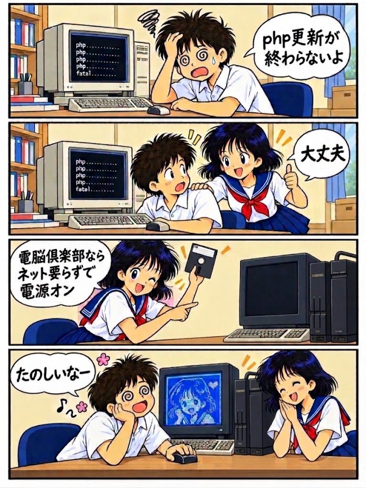
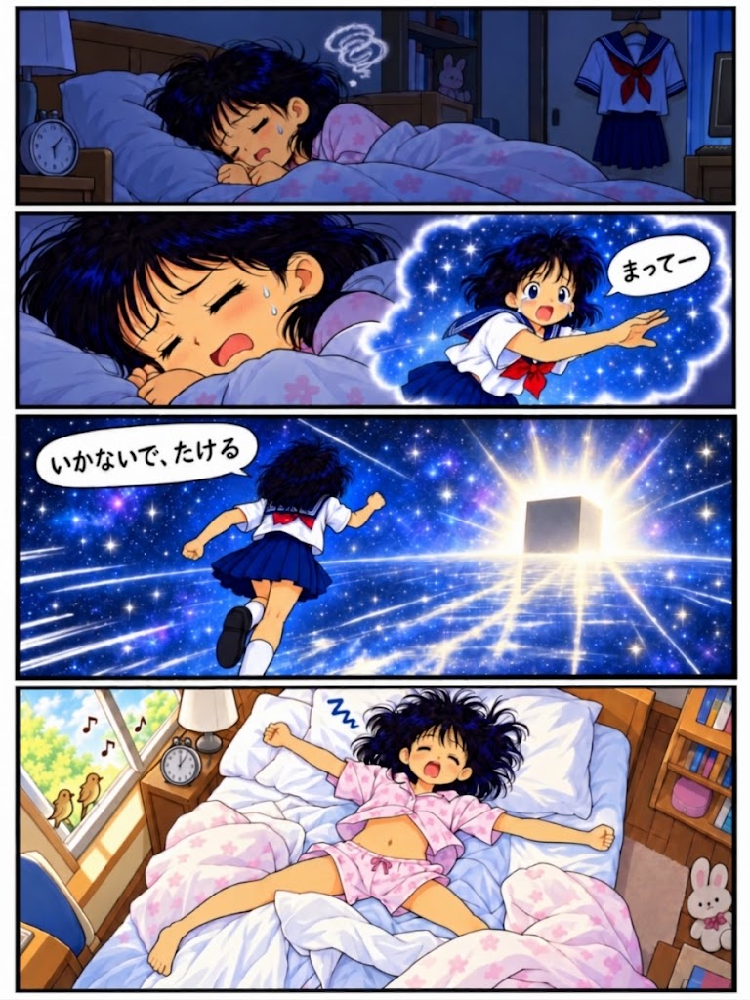
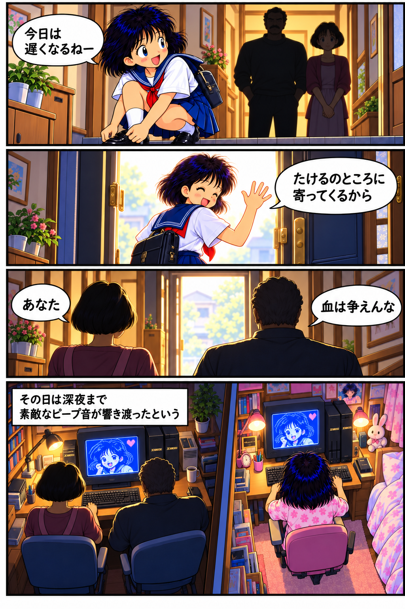
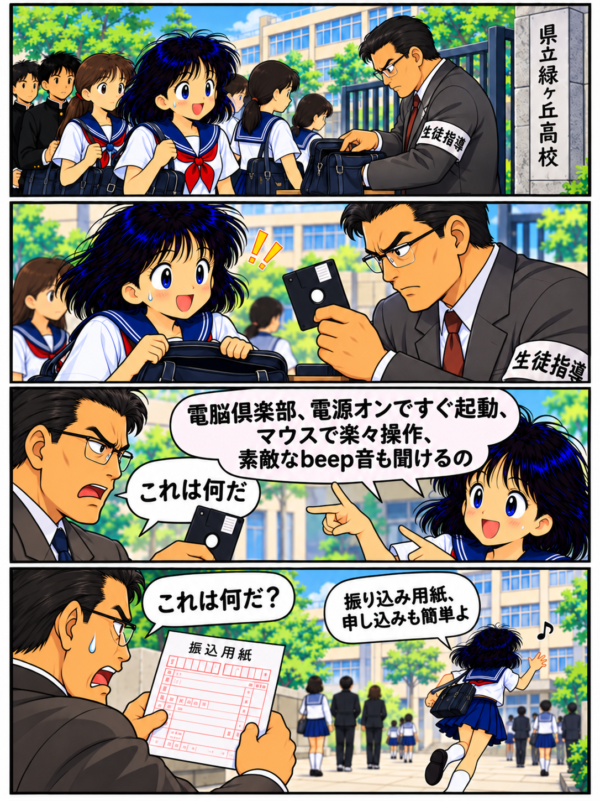
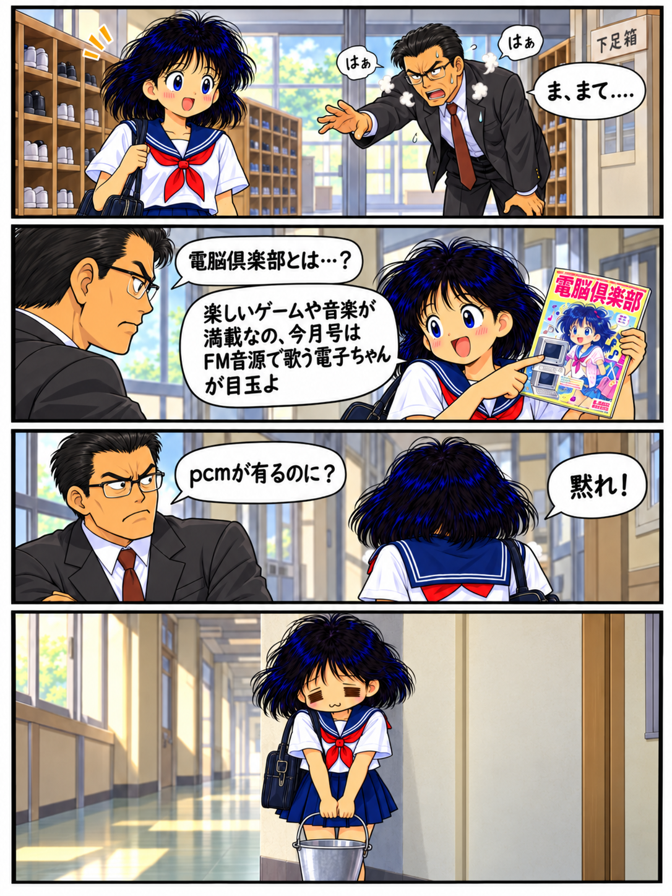
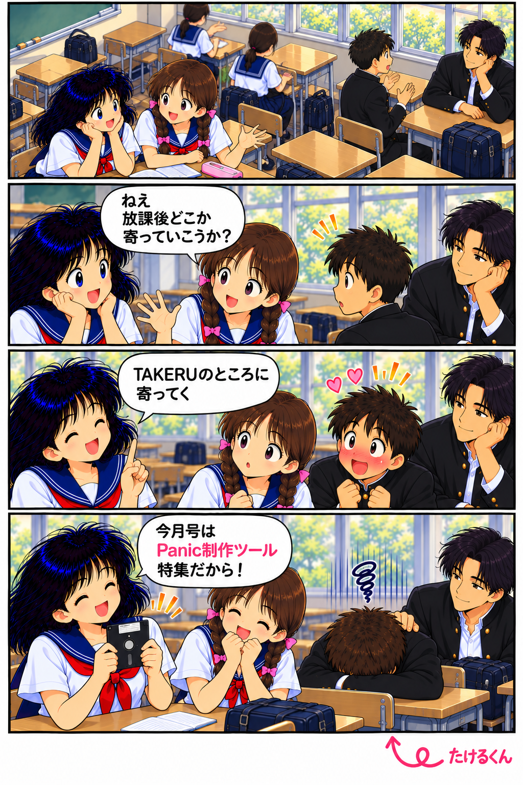

<p align="center">
  
</p>

# panicplayer

[English](README_en.md)

**panicplayer** は、M5Stack Tab5で **X68000のPANICデータ（`.PAN`）** を再生するためのPANICプレイヤーです。

PANICは、X68000上でグラフィック・スプライト・テキスト・音声などを組み合わせたアニメーションを再生するために使われていたシステムです。  
オリジナルの再生器 `panic.x` と `.PAN` データによって、当時さまざまな作品が作られていました。

panicplayerは汎用X68000エミュレータを目指したものではなく、**PANICを気軽に再生するためのX68000互換環境**として作っています。

## M5Stack Tab5

**M5Stack Tab5** は、ESP32-P4（RISC-V）、5インチ 1280×720 IPSタッチディスプレイ、32MB PSRAM、microSDカードスロット、スピーカーなどを備えた開発端末です。

この構成を使って、PANIC専用のX68000互換再生環境を動かしています。

- [M5Stack Tab5 公式ドキュメント](https://docs.m5stack.com/ja/core/Tab5)

## M5Burner

現在は **M5Burner** からインストールできます。

- [M5Burner 公式ページ](https://docs.m5stack.com/ja/uiflow/m5burner/intro)
- [M5Stack 公式ダウンロードページ](https://docs.m5stack.com/ja/download)

**M5Burner Share Code**

```text
nsDMO5hHzVw4nB1U
```

M5Burnerの **Share Burn** から上記コードを入力してください。

## 使い方

microSDカードに `.PAN` ファイルを入れて起動し、PANファイラーから再生したいデータを選びます。

- `.PAN` ファイルをタップ → 再生
- **BACK** → PANファイラーへ戻る
- **PREV / NEXT** → 前 / 次のPANデータへ移動
- **REPEAT** → SPACE待ちをするPANデータを一定間隔で自動送り
- **TURBO** → NORMAL / GREEN / RED の負荷プロファイルを切り替え
- 再生中に画面をタップ → `SPACE`

TURBOはX68000側の再生速度そのものを変えるものではなく、Tab5側の映像・音声処理の負荷バランスを切り替える機能です。選択したモードは起動中そのまま維持されます。

サンプルとして [DENKO1.PAN](https://github.com/Layer812/PanicPlayerTab5/blob/main/DENKO1.PAN) を用意しました。

## Z-MUSICについて

音楽再生には、X68000用音楽ドライバ **Z-MUSIC 2.08** を標準として採用します。Z-MUSICの作者は **西川善司氏** です。

Z-MUSICの著作権・利用条件と原資料は、[Z-MUSIC 2.08の権利表記](docs/ZMUSIC_2_08_NOTICE.md) に記載しています。

## もっとX68000を楽しみたい方へ

panicplayerはPANIC再生に特化したプレイヤーです。M5Stack Tab5でもっと汎用的なX68000環境を楽しみたい方は、**X68K Tab** もどうぞ。

- [X68K Tab](https://github.com/Layer812/X68KTab5)

## PANIC V1.38について

panicplayerでは、再生環境の一部としてオリジナルの **PANIC再生器 `panic.x` V1.38** のバイナリを使用しています。

PANIC V1.38に付属していたオリジナルドキュメントも、このリポジトリの `docs/` に収録しています。

オリジナル配布ページ：

- [X68000 LIBRARY - PANIC](http://retropc.net/x68000/software/movie/panic/panic/)

V1.38付属ドキュメントによると、

- PANICの原作者は **ぱこたん / pako こと 永田英哉さん**
- `panic.x` V1.38は、pakoさん作の V1.34を元に **なしみさん** が改変
- PANICの著作権は **永田英哉 (pako)さん** が保有
- 原作者の宣言により、PANICは利用・配布・改造・商用利用について広く許可
- 個々の `.PAN` データについては、それぞれのデータ作者の方針に従う

とされています。

**pakoさん、なしみさん、PANICの開発・資料作成・配布・データ制作に関わった皆様に感謝いたします。**

古いHDD、MO、CD-RなどにPANICデータが残っていたら、ぜひpanicplayerで再生してみてください。  
もし動かないデータがあれば、再現方法やログと一緒に知らせていただけると助かります。

## 現在の動作確認版（2026年10月24日）

- **R5Y**：実機でのPAN再生とパレット修正を確認済みです。
- 初回の256×256映像表示と、PAN選択後の再再生に対応しています。

## ソースコード

PanicPlayerTab5固有のR5Yソースは [overlays/src](overlays/src) に公開しています。共通X68000基盤は固定コミットの [X68K Tab](https://github.com/Layer812/X68KTab5) サブモジュールを利用し、PX68K由来のR5Y変更は [overlays/components/px68k](overlays/components/px68k) にあります。[ソースの出自・ハッシュ](SOURCE_PROVENANCE.md) を参照してください。

```bash
git clone --recurse-submodules https://github.com/Layer812/PanicPlayerTab5.git
```

Windows・ESP-IDF 5.5.4環境では `RUN_THIS_BUILD_PUBLIC_SOURCE.cmd` で隔離ビルドできます。これはFIX4の実ビルドPASSに基づくソース構成ですが、GitHub公開後の取得環境での再現試験と実機再検証は別です。実機へのFlashは行いません。

## Special Thanks

**Nochiさん**

## 著作権・謝辞

- **Panic Player Tab5の新規コード**：© 2026 Layer812
- **PANIC / `PANIC.X`**：原作者・著作権者 **永田英哉（pako／ぱこたん）さん**、V1.38改訂 **なしみさん**。原版の文書・条件を優先します
- **Z-MUSIC SYSTEM v2.08**：著作権者 **西川善司氏**。[権利表記と原資料](docs/ZMUSIC_2_08_NOTICE.md)を参照してください。
- **Musashi**：© Karl Stenerudおよび貢献者（MIT License）
- **PX68K / WinX68k / xkeropi**：X68000エミュレータの開発・移植・調査に携わった皆様
- **各 `.PAN` 作品**：映像・音楽・データの権利は各制作・権利者に帰属します
- **SHARP X68000**：SHARPおよび各権利者の名称・商標。非公式・非公認の個人プロジェクトです

**PANIC本体の配布許諾と、PANデータの配布許諾は別です。** 詳細・一次資料は [THIRD_PARTY_NOTICES.md](https://github.com/Layer812/PanicPlayerWeb/blob/main/THIRD_PARTY_NOTICES.md)、[LICENSE_PANIC_X.txt](https://github.com/Layer812/PanicPlayerWeb/blob/main/LICENSE_PANIC_X.txt)、[PANIC_V1.38_NOTICE.txt](https://github.com/Layer812/PanicPlayerWeb/blob/main/PANIC_V1.38_NOTICE.txt) を参照してください。PANICのオリジナル文書は [PanicPlayerTab5のdocs](https://github.com/Layer812/PanicPlayerTab5/tree/main/docs) に保存されています。[SHARP/FSHARPの原許諾条件](LICENSE_SHARP_X68000.txt) と [X68K Tabの第三者ライセンス詳細](https://github.com/Layer812/X68KTab5/blob/main/THIRD_PARTY_NOTICES.md) も参照してください。

**Panic Player WebのMITライセンスは、Layer812が権利を持つWeb版の新規実装部分にのみ適用されます。** 本Tab5リポジトリや第三者のコード・実行形式・各PANへ自動的に適用されるものではありません。各素材の原許諾条件を優先します。

PANICとX68000の文化を支え、貴重なデータを保存されてきた皆様に感謝します。

## デンコ（仮称）の漫画

「このPanic Player関連の営みが、もし『電脳倶楽部』の企画だったら？」という仮想空間を舞台にした漫画を掲載しています。**現在は -1 ～ 4 を公開中**。**5 ～ 8 は順次追加予定**です。

漫画の中でたびたび登場する **「FM音源で歌うPanic」** は、ブラウザ版でも再生できます。**[「FM音源で歌うPanic」を見る・再生する](https://layer812.github.io/PanicPlayerWeb/?pan=DENKOSN)**

サムネイルをクリックすると元の画像を開けます。

※実際の「電脳倶楽部」による公式企画・公式作品ではなく、架空の設定に基づく創作です。

<table>
<tr>
  <td align="center" width="33%"><a href="./denko-1.png"></a><p><strong>-1</strong></p></td>
  <td align="center" width="33%"><a href="./denko0.png"></a><p><strong>0</strong></p></td>
  <td align="center" width="33%"><a href="./denko1.png"></a><p><strong>1</strong></p></td>
</tr>
<tr>
  <td align="center" width="33%"><a href="./denko2.png"></a><p><strong>2</strong></p></td>
  <td align="center" width="33%"><a href="./denko3.png"></a><p><strong>3</strong></p></td>
  <td align="center" width="33%"><a href="./denko4.png"></a><p><strong>4</strong></p></td>
</tr>
</table>

※漫画画像の取り扱いは、PANIC.Xや各 `.PAN` データの配布条件とは別です。
